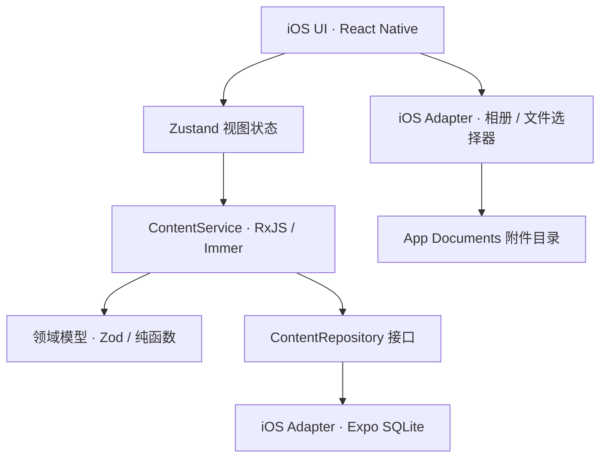

# 架构与演进路线

## 0.0.2 边界

首版只交付 iOS 本地内容库，不引入账号、云端同步或公开内容社区。这让媒体导入、离线浏览和内容组织可以先形成完整闭环，同时不把平台 API 泄漏进共享核心。



### 核心层

`packages/core` 按领域组织，包含：

- `domain/content.ts`：内容、附件、草稿 Schema 以及内容类型推断
- `domain/query.ts`：平台无关的搜索、筛选和排序
- `application/content-service.ts`：发布、收藏、删除和响应式状态流
- `application/content-repository.ts`：持久化端口

所有时间和 ID 都从构造参数注入，因此核心逻辑可重复测试。

### iOS 适配层

- UI：React Native 原生组件 + 项目内轻量 Design Tokens
- 路由：Expo Router（文件路由）
- 状态：Zustand，桥接共享 `ContentService`
- 数据：Expo SQLite，WAL 模式
- 媒体：Expo Image Picker / Document Picker
- 播放：Expo Video / Audio
- 新架构：`newArchEnabled: true`，使用 Fabric、TurboModules 与 JSI

附件先复制到 App Documents，再写入 SQLite。发布被取消时单个移除的附件会立即清理；删除已发布内容也会清理全部附件。

## 后端与同步设计（已落地基础）

后端位于 `apps/api`，采用 NestJS 11 + PostgreSQL + Prisma；Redis 缓存和限流仍属于生产部署阶段：

```text
REST Controller → Application Service → Repository → PostgreSQL
                                      ↘ Cache → Redis
                                      ↘ Object Storage
```

客户端仍调用核心应用服务，并通过 Sync Coordinator 协调本地队列和 API Client。文件使用预签名 URL 直传对象存储；服务端保存内容元数据、附件索引、项目关系和版本号。同步协议已经包含 `revision`、`deletedAt` 与幂等请求键，用于处理离线修改、重复提交和显式冲突。

内容版本使用不可变快照：正文编辑必须创建更高的语义版本，同版本只允许同步点赞、收藏、阅读等非版本数据。项目内容的审核由所有关联项目的角色共同决定，驳回当前版本恢复最近的已通过快照，避免未审核内容继续向外部展示。

个人合集由服务端 `collections` 与 `collection_items` 保存，`position` 是唯一排序依据。Core 统一约束合集只能包含同类型个人内容；小程序纵向 Swiper 只激活当前页媒体，并在页面切换时暂停视频或销毁音频上下文。

评论是独立服务端实体，回复通过自关联保存，用户点赞使用 `comment_likes` 多对多关系而不是客户端布尔值。评论数与分享数更新内容 revision，使其他设备继续通过既有增量同步获得权威指标；分享落地读取仍复用内容可见性规则。

安全基线包括 JWT + refresh token 轮换、单实例固定窗口限流、请求 ID、结构化访问日志、Zod 边界校验、MIME 与文件大小限制，以及微信文本内容安全检查。对象上传后的魔数复核、恶意文件扫描、媒体内容安全和多实例共享限流仍是生产部署阻塞项。

## 多平台里程碑

1. `0.0.2` iOS：本地发布、媒体与文件、搜索筛选、收藏。
2. Android：复用 `@atlas/core` 与大部分 React Native UI，补齐权限、文件 URI 和返回键适配。
3. 微信小程序：Taro 适配层，小程序存储 + 云端同步，当前优先开发至生产版本。
4. PC Web：Next.js App Router + shadcn/ui，Dexie.js 实现 IndexedDB Repository；服务端渲染只覆盖公开内容页。

## 工程约束

- 新业务规则优先进入 `packages/core`，不得读取 `Platform`、DOM、文件系统或数据库。
- 平台能力通过接口注入；附件 URI 只被视作不透明标识。
- Zod Schema 是跨端数据边界，数据库和网络返回必须解析后使用。
- 任何数据库迁移都要可前向升级，不能依赖卸载重装。
- 当前使用 Jest + SWC 测试核心包；引入 React 组件测试时增加 React Native Testing Library，后端落地时增加 Supertest。
